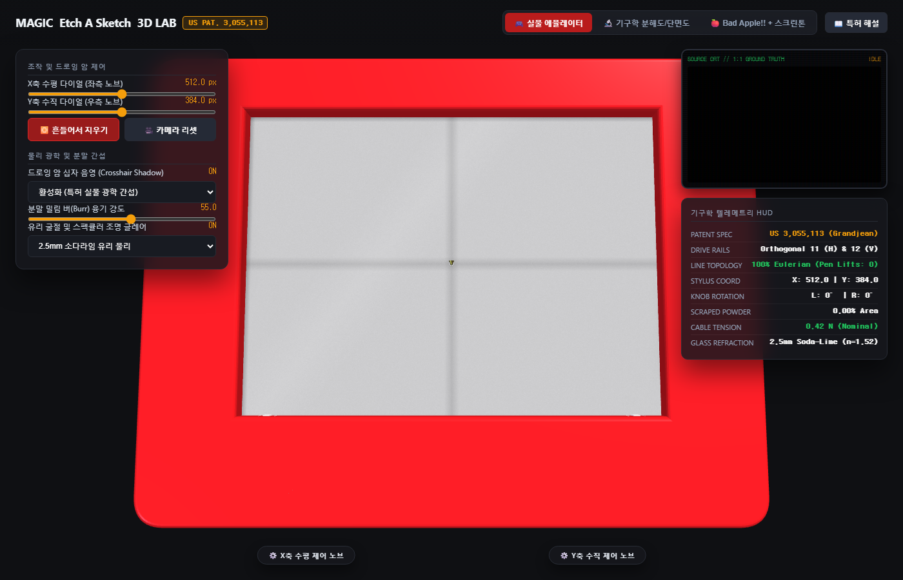

# etch-a-sketch-3d-lab

Interactive 3D mechanical emulator, educational cutaway/exploded view analyzer, and Bad Apple!! player based on **US Patent 3,055,113** (*"Tracing Device"*, Arthur Grandjean / André Cassagnes, 1962).

[](LICENSE)
[]()
[](https://minicom365.github.io/etch-a-sketch-3d-lab/)



## Core Features

- **Interactive 3D Toy Emulator**:
  - Full 3D orbit rotation, panning, and zoom.
  - Classic Ohio Art cherry-red molded chassis with gold hot-stamped typography.
  - Realistic 3D knurled white rotary dials with physical rotation kinematics linked to $X$ and $Y$ displacements.
  - Realistic "Shake to Erase" animation with tumbling polystyrene circulation beads and powder re-coating.
- **US Patent 3,055,113 Engineering Cutaway & Exploded View**:
  - Continuous 3D exploded view slider (0% to 100%) separating the top case, 2.5mm soda-lime glass, screen powder layer, orthogonal guide rails (Rods 11 & 12), brass stylus carriage, endless wire cables, pulleys, and bottom tray.
  - X-ray cutaway transparency control.
  - Interactive patent component annotations and mechanical breakdown.
- **Physical Optical Imperfections**:
  - **Drawing Arm Interference**: Internal diffuse crosshair shadow cast by the steel rods through the translucent powder, plus specular steel/brass reflections through cleared grooves.
  - **Powder Scraping Optics**: Displaced aluminum burr ridges (bright edge glow), incomplete scraping graphite haze (#242220), and studio specular glare.
- **Bad Apple!! + light-screentone Integration**:
  - Real-time Bad Apple playback using 100% continuous Eulerian polylines (`Pen Lifts: 0`).
  - Integrated `light-screentone` engine supporting boustrophedon hatching, halftone dot matrix, line screen, and crosshatching.
  - Synchronized CRT green-phosphor source monitor and procedural Web Audio chiptune synthesizer.
  - Real-time kinematic telemetry dashboard (stylus coordinates, dial angles, cable tension, scraped powder ratio).

## Project Structure

```
etch-a-sketch-3d-lab/
├── index.html                   # All-in-One 3D Education Kit & Player
├── light-screentone.js          # Sub-library: Functional B&W Screentoning & Halftone Engine
├── bad_apple_data.js            # Embedded Bad Apple Landmark Frames
├── three.min.js                 # Standalone Three.js r128 bundle (Offline ready)
├── OrbitControls.js             # Standalone Three.js OrbitControls
├── PATENT_US3055113_ANALYSIS.md # Mechanical Engineering Patent Reverse-Engineering Report
├── README.md                    # Official English Guide
├── README_KO.md                 # Detailed Korean Guide
└── assets/                      # Preview images and snapshots
```

## Running Locally

Simply open `index.html` in any modern web browser. No web server, Node.js, or build steps required.

```bash
# Optional: serve with python or any static server
python -m http.server 8080
```

## License

MIT License. (C) 2026 Minicom365.
