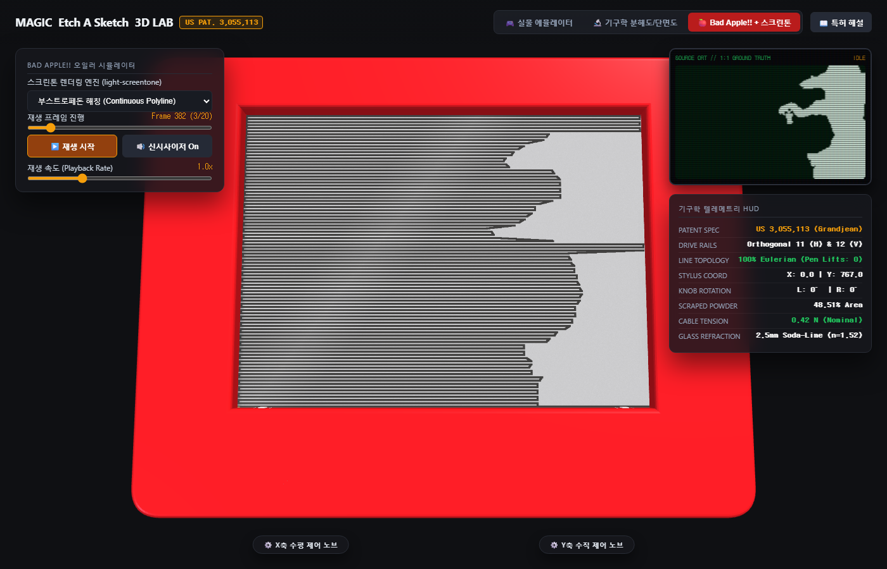

# etch-a-sketch-3d-lab (한국어 상세 가이드)

미국 특허 **US Patent 3,055,113** (Arthur Grandjean / André Cassagnes, 1962년 등록, *"Tracing Device"*)의 기계공학적 원리를 바탕으로 제작된 **3차원 인터랙티브 에치 어 스케치 물리 에뮬레이터, 기구학 분해도/단면도 분석 에듀케이션 키트 및 Bad Apple!! 재생기**입니다.

[](LICENSE)
[]()
[](https://minicom365.github.io/etch-a-sketch-3d-lab/)


---

## 1. 프로젝트 개요

단순한 2D 픽셀 그림 그리기를 넘어, 실제 에치 어 스케치 하드웨어가 가진 **직교 강철 가이드 로드 구동계**, **드로잉 암의 광학적 간섭(내부 십자 그림자 및 스크래치 개구부 강철 반사)**, **알루미늄 분말 둔덕(버 융기)과 흑연 헤이즈**, **2.5mm 소다라임 유리의 굴절**을 3D WebGL 환경에서 재현한 공학 교육용 올인원(AIO) 키트입니다.

외부 서버나 복잡한 빌드 도구 없이 브라우저에서 `index.html` 파일을 더블클릭하는 것만으로 오프라인에서도 완전 동작하도록 **최소 의존성/무의존성**으로 설계되었습니다.

---

## 2. 3대 핵심 모드

### 🎮 모드 1: 실물 인터랙티브 3D 에뮬레이터
- **3D 자유 관측**: 마우스 드래그로 360도 회전, 휠 줌, 우클릭 패닝.
- **클래식 오하이오 아트 체리 레드 섀시**: 금박 핫스탬프 타이포그래피 (`MAGIC Etch A Sketch SCREEN - US PAT. 3,055,113`).
- **3D 널링 회전 노브**: 24개 톱니 플루트를 지닌 백색 다이얼 노브가 스타일러스의 $X$축, $Y$축 이동 변위에 맞춰 실시간 회전.
- **흔들어서 지우기 (Shake to Erase)**: 버튼 클릭 시 3D 본체가 덜컹거리며 진동하고, 챔버 내부의 폴리스티렌 비즈가 구르며 알루미늄 분말을 재도포하여 화면을 깨끗이 초기화.

### 🔬 모드 2: US Patent 3,055,113 기구학 분해도 및 단면도 분석

- **3D 폭발 분해도 (Exploded View, 0% ~ 100%)**:
  1. 상부 체리 레드 섀시
  2. 2.5mm 소다라임 유리판
  3. 알루미늄 분말 및 비즈 층
  4. 황동 스타일러스 캐리지 및 판스프링
  5. 수직 강철 가이드 로드 (Rod 12)
  6. 수평 강철 가이드 로드 (Rod 11)
  7. 무단 와이어 케이블 (Cables 13, 14) 및 4대 코너 풀리 (Pulleys 15, 16)
  8. 하부 밀폐 섀시
- **투명도(X-Ray) 슬라이더**: 상부 섀시를 반투명하게 만들어 내부 기구학 부품이 동작하는 모습을 실시간 투시 관찰.
- **특허 명세 해설**: 1962년 특허 원문의 동작 원리와 엔지니어링 설계 이유를 담은 모달 탑재.

### 🍎 모드 3: Bad Apple!! + light-screentone 연동 시뮬레이터

- **100% 무절단 오일러 경로 (Pen Lifts: 0)**: 펜을 들 수 없는 물리적 제약을 준수하여, 배경 여백을 횡단하는 흉한 직선 없이 화면 외곽 베젤 테두리를 타고 은폐 이동하는 정밀 궤적 생성.
- **`light-screentone` 라이브러리 연동**: 단순 이진 해칭 외에도 도트 하프톤 매트릭스, 라인 스크린톤, 크로스해칭, 베이어 디더링을 실시간 전환.
- **CRT 소스 모니터 & Web Audio 신시사이저**: 우측 상단 그린 포스퍼 CRT 스캔라인 모니터와 프로시저럴 사각파 신시사이저를 통한 음악 동기화 재생.
- **실시간 텔레메트리 HUD**: 로드 좌표, 다이얼 회전각, 케이블 장력, 분말 박리율 실시간 출력.

---

## 3. 파일 구성

- `index.html`: Three.js 기반 3D 물리 에뮬레이터 및 UI 일체형 웹 애플리케이션.
- `light-screentone.js`: 초경량 함수형 흑백 이진 스크린톤 및 오일러 벡터 생성기.
- `bad_apple_data.js`: 임베디드 Bad Apple 랜드마크 프레임 데이터셋.
- `three.min.js` & `OrbitControls.js`: 오프라인 구동을 위한 Three.js r128 독립 번들.
- `PATENT_US3055113_ANALYSIS.md`: 미국 특허 3,055,113 기계공학 역공학 상세 분석서.
- `assets/`: 실측 검증 프리뷰 스냅샷.

---

## 4. 로컬 실행 및 배포

별도의 빌드나 의존성 설치 없이 웹 브라우저에서 `index.html` 파일을 열면 즉시 실행됩니다.

```bash
# 로컬 정적 웹 서버 구동 (선택 사항)
python -m http.server 8080
```

- **GitHub Pages 라이브 배포 주소**:  
  https://minicom365.github.io/etch-a-sketch-3d-lab/

---

## 5. 라이선스

MIT License. (C) 2026 Minicom365.
