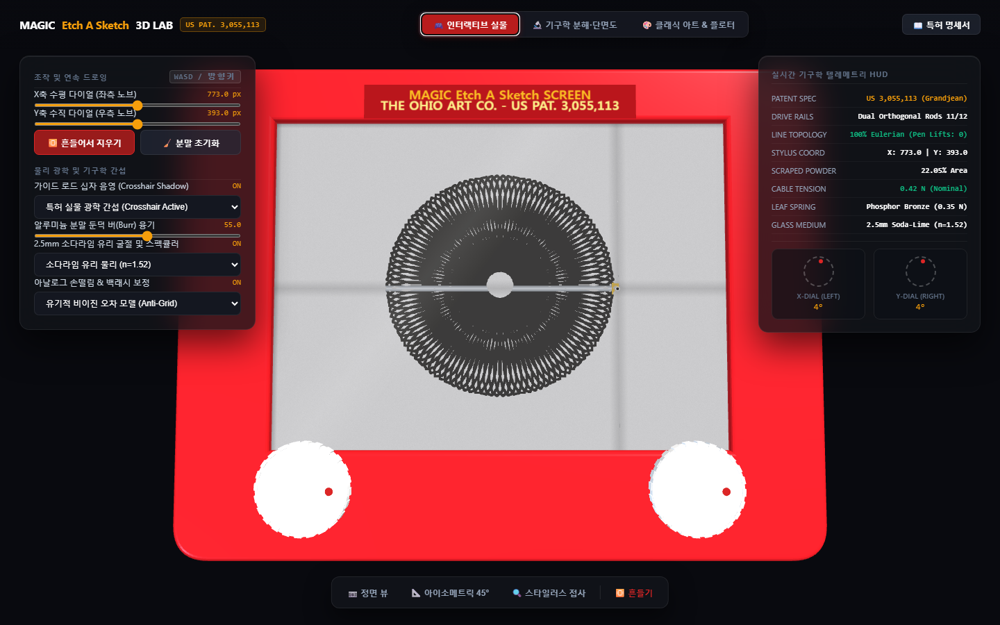
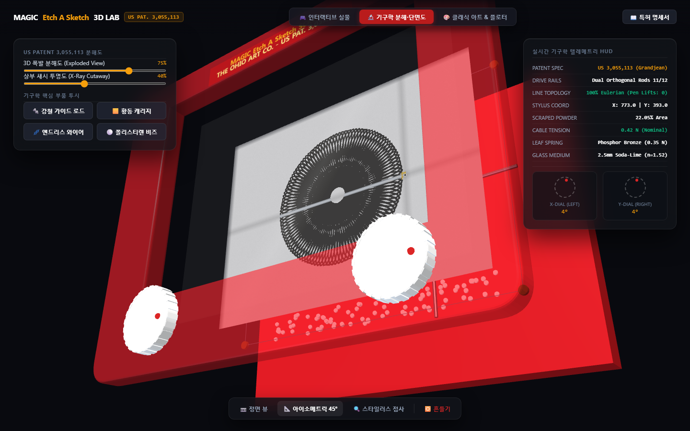
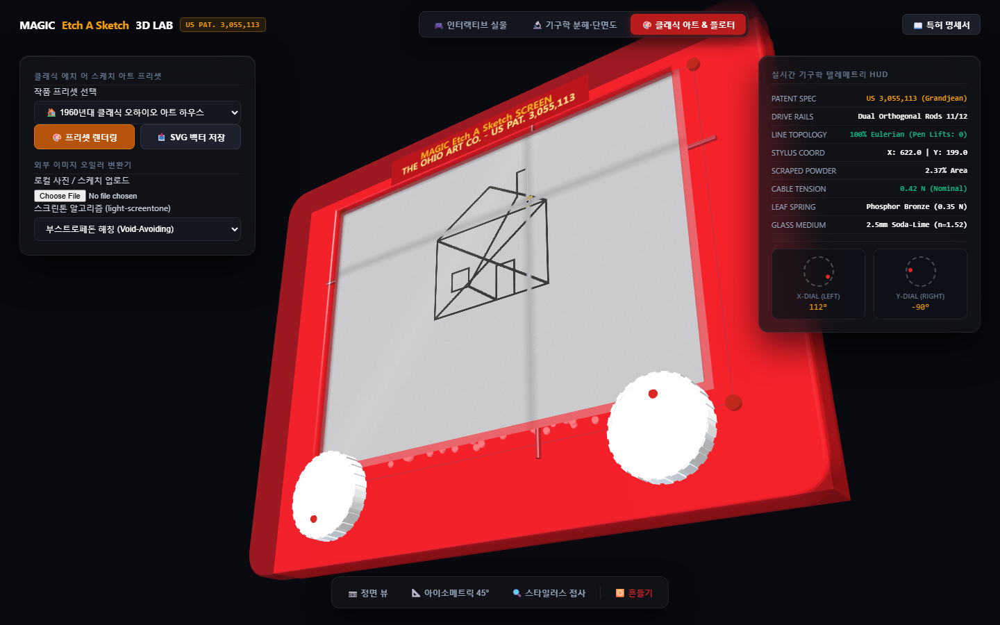

# etch-a-sketch-3d-lab (한국어 상세 가이드)

미국 특허 **US Patent 3,055,113** (Arthur Grandjean / André Cassagnes, 1962년 등록, *"Tracing Device"*)의 기계공학적 원리를 바탕으로 제작된 **3차원 인터랙티브 에치 어 스케치 물리 에뮬레이터, 기구학 분해도/단면도 분석 에듀케이션 키트 및 1-라인 오일러 벡터 플로터**입니다.

[](LICENSE)
[]()
[](https://minicom365.github.io/etch-a-sketch-3d-lab/)



---

## 1. 프로젝트 개요

단순한 2D 픽셀 캔버스 조작을 넘어, 실제 에치 어 스케치 하드웨어가 가진 **직교 강철 가이드 로드 구동계**, **드로잉 암의 광학적 간섭(내부 십자 그림자 및 스크래치 개구부 강철 반사)**, **알루미늄 분말 둔덕(버 융기)과 흑연 헤이즈**, **2.5mm 소다라임 유리의 굴절**을 3D WebGL 환경에서 완전 시뮬레이션한 공학 교육용 올인원(AIO) 키트입니다.

외부 서버나 npm 빌드 과정 없이 웹 브라우저에서 `index.html` 파일을 여는 것만으로 오프라인에서도 완전 동작하도록 **최소 의존성/무의존성**으로 설계되었습니다.

---

## 2. 3대 핵심 모드

### 🎮 모드 1: 실물 인터랙티브 3D 에뮬레이터
- **3D 자유 관측 및 시점 프리셋**: 마우스 드래그로 360도 회전, 휠 줌, 우클릭 패닝. 정면 뷰, 45도 아이소메트릭 뷰, 스타일러스 팁 매크로 접사 뷰 원클릭 전환 지원.
- **클래식 오하이오 아트 체리 레드 섀시**: 금박 핫스탬프 타이포그래피 (`MAGIC Etch A Sketch SCREEN - US PAT. 3,055,113`) 및 정밀 널링(24개 플루트) 백색 노브 완벽 구현.
- **물리적 노브 회전 연동**: 좌측 수평($X$), 우측 수직($Y$) 다이얼 노브가 스타일러스 이동량에 맞춰 실시간으로 정확한 각도로 회전.
- **흔들어서 지우기 (Shake to Erase)**: 버튼 클릭 시 3D 본체가 덜컹거리며 진동하고, 챔버 내부의 90여 개 폴리스티렌 비즈가 구르며 알루미늄 분말을 재도포하여 화면을 초기화.
- **버터처럼 부드러운 키보드 조작**: 60 FPS 연속 게임 루프(WASD / 방향키)를 통해 끊김이나 이산적 점선 현상 없는 연속선 드로잉 지원.

### 🔬 모드 2: US Patent 3,055,113 기구학 분해도 및 단면도 분석

- **3D 폭발 분해도 (Exploded View, 0% ~ 100%)**:
  1. 상부 체리 레드 섀시 ($Z = 19$)
  2. 2.5mm 소다라임 유리판 ($Z = 13.5$)
  3. 알루미늄 분말 층 ($Z = 11.8$)
  4. 황동 스타일러스 캐리지 및 인청동 판스프링 ($Z = 5.0$)
  5. 수직 강철 가이드 로드 (Rod 12, $X$축 이동)
  6. 수평 강철 가이드 로드 (Rod 11, $Y$축 이동)
  7. 무단 강철 와이어 케이블 (Cables 13, 14) 및 4대 코너 아이들러 풀리 (Pulleys 15, 16)
  8. 하부 밀폐 섀시 ($Z = -13$)
- **X-Ray 투명도 슬라이더**: 상부 섀시를 0%~100% 반투명하게 만들어 선을 그리는 동안 내부 기계 구동계가 움직이는 모습을 실시간 투시 관찰.
- **실시간 기구학 텔레메트리 HUD**: 스타일러스 2D/3D 좌표, 좌/우 다이얼 회전각, 케이블 장력, 스프링 압력, 박리된 분말 면적률을 실시간 수치화.

### 🎨 모드 3: 단일 획(One-Line) 오일러 벡터 플로터 & 스크린톤 컨버터

- **4대 클래식 수학/공학 프리셋**:
  - **스파이로그래프 (Hypotrochoid)**: 다중 루프 기하학적 로제트 문양.
  - **1960년대 클래식 오하이오 아트 하우스**: 박공지붕, 굴뚝, X자 버팀대, 문을 단 한 번의 붓 떼기 없이 완성하는 역사적 도면.
  - **모나리자 1-라인**: 연속 윤곽 및 톤 마스크 초상화.
  - **리사주 고조파 공명 (Lissajous)**: 3:4 직교 조화 진동 곡선.
- **사용자 사진/이미지 벡터 변환기**: 사용자 로컬 이미지를 업로드하면 내장 서브라이브러리 `light-screentone`을 통해 부스트로페돈 해칭, 도트 매트릭스 하프톤, 라인 스크린, 크로스해칭, 베이어 디더링 궤적으로 실시간 변환.
- **기구학 제약 및 물리 결함 모델링**:
  - **무절단 오일러 경로 (Pen Lifts: 0)**: 물리적으로 펜을 뗄 수 없는 제약을 준수하여, 배경 여백을 직선으로 침범하지 않고 외곽 베젤 테두리 그림자를 타고 우회(Detour) 이동.
  - **유기적 비이진 오차 모델링 (손떨림 & 백래시)**: 컴퓨터 특유의 완벽한 수직/수평 격자가 나타나지 않도록 인체 신경근 분산($\sigma \approx 0.6\text{ px}$) 및 케이블 백래시($0.5\text{ px}$)를 에르미트(Hermite) 스플라인으로 모델링.
  - **드로잉 암 광학 간섭**: 분말 투과 십자 그림자 및 스크래치 홈 내부의 강철 로드 경면 반사 효과 반영.
- **벡터 SVG 원클릭 내보내기**: 펜 플로터 및 CNC 조각기에서 직접 사용 가능한 단일 연속 폴리라인 SVG 파일 즉시 다운로드.

---

## 3. 파일 구성

```
etch-a-sketch-3d-lab/
├── index.html                   # 3D WebGL 시뮬레이터 및 통합 UI
├── light-screentone.js          # 서브 라이브러리: 경량 함수형 흑백 스크린톤 & 오일러 벡터 엔진
├── three.min.js                 # Three.js r128 독립 번들 (오프라인 완전 구동)
├── OrbitControls.js             # Three.js OrbitControls 독립 번들
├── PATENT_US3055113_ANALYSIS.md # 미국 특허 3,055,113 기계공학 역공학 상세 분석서
├── README.md                    # 공식 영문 문서
├── README_KO.md                 # 상세 한국어 가이드
└── assets/
    ├── preview_toy.png          # 모드 1 실물 에뮬레이터 실측 스크린샷
    ├── preview_cutaway.png      # 모드 2 기구학 분해도 실측 스크린샷
    └── preview_plotter.png      # 모드 3 오일러 플로터 실측 스크린샷
```

---

## 4. 로컬 실행 및 배포

별도의 빌드 도구 설치 없이 웹 브라우저에서 `index.html` 파일을 더블클릭하면 즉시 실행됩니다.

```powershell
# 로컬 정적 웹 서버 구동 (선택 사항)
python -m http.server 8080
```

- **GitHub Pages 라이브 배포 주소**:  
  https://minicom365.github.io/etch-a-sketch-3d-lab/

---

## 5. 라이선스

MIT License. (C) 2026 Minicom365.
