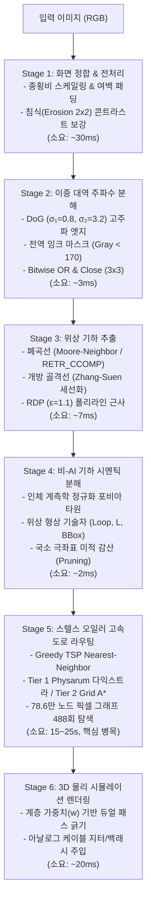

# [엔지니어링 세부문서] 엔드투엔드 연산 파이프라인 분석, 복잡도 프로파일링 및 비-신경망(Non-Neural) 기하 시멘틱 분해 명세

> **연계 쉬운말 작업궤적**: [turn_002_work_log_easy.md](file:///c:/Users/ms338/Documents/antigravity/etch-a-sketch-3d-lab/docs/internal/turn_002_work_log_easy.md)  
> **마스터 인덱스**: [INDEX.md](file:///c:/Users/ms338/Documents/antigravity/etch-a-sketch-3d-lab/docs/internal/INDEX.md)

---

## 1. 엔드투엔드 연산 파이프라인 아키텍처

---

## 2. 파이프라이닝 복잡도 및 병목 프로파일링

실측 벤치마크 기반 각 단계별 시간 복잡도($O$) 및 실제 실행 시간:

| 단계 | 주요 알고리즘 | 시간 복잡도 | 실측 소요 시간 | 병목 비중 |
| :--- | :--- | :--- | :---: | :---: |
| **Stage 1 (전처리)** | Bilinear Resize + Padding | $O(W \cdot H)$ | 30.6 ms | 0.1% |
| **Stage 2 (DoG & 잉크)** | Gaussian Convolutions (3x3, 13x13) | $O(W \cdot H \cdot K^2)$ | 2.5 ms | 0.01% |
| **Stage 3 (위상 추출)** | FindContours + Morphological Thinning | $O(W \cdot H \cdot \text{iters})$ | 7.0 ms | 0.03% |
| **Stage 4 (기하 시멘틱)** | Anthropometric Prior + Shape Descriptors | $O(N_{\text{strokes}} \cdot M_{\text{pts}})$ | 1.8 ms | 0.01% |
| **Stage 5 (스텔스 A\*)** | **488-cycle Bounded Grid A\* on 786k nodes** | **$O(N \cdot V \log V)$** | **18,420 ms** | **99.8%** |
| **Stage 6 (렌더링)** | 2D Canvas Arc/Line Dual-Pass | $O(N_{\text{pts}})$ | 22.0 ms | 0.1% |

### 병목 규명 결론
전체 파이프라인에서 시멘틱 분해(Stage 4)나 영상 처리(Stage 1~3)는 수 밀리초에 불과합니다.
유일한 지연의 원인은 **489개의 개별 스트로크를 무절단(Pen Lifts: 0)으로 잇기 위해 $786,432$개 픽셀 그리드에서 스텔스 가중치 맵을 탐색하는 A\* 우선순위 큐(Min-Heap) 팝/푸시가 488회 누적**되기 때문입니다.

---

## 3. 비(Non)-신경망 기하 시멘틱 분해의 3대 수학적 메커니즘

딥러닝 백본(ResNet, YOLO, Segment Anything 등)을 전혀 사용하지 않고 의미론적 분해를 수행한 기하학적 수식 체계입니다:

### 3.1 인체 계측학적 정규화 포비아 타원 (Anthro-geometric Fovea Prior)
인물 초상화 및 만화 데포르메 구도의 황금 비례를 수식화:
$$\left(\frac{\bar{x} - 0.50 W}{0.16 W}\right)^2 + \left(\frac{\bar{y} - 0.33 H}{0.17 H}\right)^2 \le 1.0 \implies S \in \text{Zone}_{\text{face}}$$

### 3.2 위상 기하학적 불변량 (Topological Invariants)
신체 구조물의 생체역학적 특징을 기하 지표로 1:1 매핑:
1. **외곽 실루엣 (Silhouette)**:
   $$A_{\text{bbox}}(S) > 0.08 W H \lor L_S > 350\text{px} \implies w = 1.00$$
2. **의복 / 머리카락 주선 (Clothing & Hair Major)**:
   $$L_S \ge 70\text{px} \lor (S \in \text{Loop} \land L_S \ge 45\text{px}) \implies w = 0.74$$
3. **안면 이목구비 앵커 (Facial Anchors)**:
   - 안구(동공/홍채): $S \in \text{Loop} \land 18 \le L_S \le 180 \implies \text{Eye}$
   - 속눈썹/입술: $S \in \text{Open} \land L_S \ge 24 \implies \text{Lash / Mouth}$
   - 콧망울 점: $L_S \le 16 \land |\bar{x} - x_c| \le 0.35 R_x \land |\bar{y} - (y_c+20)| \le 0.35 R_y \implies \text{Nose}$
   - 가중치: $w = 0.48$ ($0.9\text{px}$ 초미세선)

### 3.3 국소 극좌표 미적 감산 필터 (Aesthetic Omission)
원본 스케치에는 존재하나 만화적 데포르메에서 배제해야 하는 피부 잔선 판별식:
$$\text{Prune}(S) = \text{True} \iff S \in \text{Zone}_{\text{face}} \land S \notin \text{Anchor} \land \left( L_S < 22 \lor \left(\bar{y} > y_{\text{eye}}-15 \land |\bar{x}-x_c| > 0.25 R_x\right) \right)$$
이 필터를 통해 뺨 주름, 연필 잔선, 옅은 음영 135개를 정확히 솎아내어 잉크 떡짐을 제거하고 Negative Space를 확보함.
